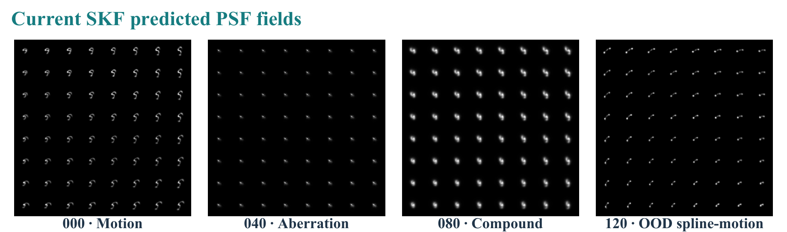

# SKF-Diff

Core implementation and illustrations for **Blind Spatially Variant Image Deblurring via Structured Kernel-Field Prediction and Diffusion Reconstruction**.

SKF-Diff predicts an achromatic 8×8 field of 31×31 point-spread functions from a blurred RGB image. Spatial features and local power spectra feed a shared root-field component and a direct root residual. Positive-square decoding enforces nonnegative, unit-mass PSFs. The predicted field stays fixed while an unconditional image diffusion prior alternates with whole-image proximal consistency.



## What is included

- `skfdiff/base.py`: multiscale spatial encoder and frozen square-root PCA codec.
- `skfdiff/predictor.py`: spatial–spectral predictor and direct root residual.
- `skfdiff/operators.py`: continuously interpolated PSF action, matching adjoint and conjugate-gradient proximal solve.
- `skfdiff/reconstruction.py`: the fixed-field, two-trajectory reconstruction recipe.
- `skfdiff/losses.py`: supervised kernel-shape and normalized operator-response loss.
- `tests/`: synthetic CPU checks of decoding, adjoint, loss and endpoint semantics.
- `assets/`: paper diagrams and representative qualitative panels; these illustrate completed results, not outputs of the toy demo.

This is a **core-code research release**. Trained predictor weights, fitted PCA buffers, pretrained ImageNet U-Net weights, source images and the complete training/data-generation pipeline are not included. Random initialization or the synthetic demo cannot reproduce the paper's accuracy. The code does not download models, start training, or inspect a GPU on import.

## Install and check

Use Python 3.8 or later and a compatible PyTorch installation:

```bash
python -m pip install -e .
python -m unittest discover -s tests -v
python examples/synthetic_demo.py
```

Tests and the demo use synthetic tensors on CPU. To build the complete predictor, provide a fitted `FrozenRootPCACodec(mean,basis,scale)` with rank 256 and geometry 8×8×31×31. Load a trusted selected predictor state dictionary before real inference. The optional `reconstruct_mean` API also needs a frozen unconditional noise-prediction U-Net supplied by the caller; it is not a Stable Diffusion replacement.

## Numerical conventions

The network input is `[B,3,256,256]` RGB. Predicted nodes have shape `[B,8,8,31,31]`. A 32×32 padded tile is only a storage convention. Bilinear field weights act at output pixels; convolution uses neighboring image pixels across internal tile boundaries and zero padding only at the outer image boundary. Inference uses one predicted field for both prescribed seeds 0 and 3. Each trajectory has 100 levels from zero-based index 200 to 0, at most 12 CG iterations per level, and returns the **last denoiser prior**, before the final proximal correction. The two raw images are averaged in FP64 and cast to FP32. Image evaluation clips the mean to [0,1].

See [method and training settings](docs/method.md), [reported results and limitations](docs/results.md), and [release scope](docs/release_scope.md).

## Authors

Suining Gao, Chunshu Li, Zongqiang Fu, and Xiubin Yang.

The manuscript is under revision. Publication metadata and the final citation will be added when available.

## Rights and dependencies

A public source license has not yet been designated by the authors. Public availability does not relicense third-party models or images. This repository does not bundle third-party model code, model weights, or font files. PyTorch, NumPy and Pillow retain their own licenses. Natural photographs used in the displayed paper panels originate from OpenImages and remain subject to their original image licenses; see the manuscript's dataset citation. The illustrations are not a dataset redistribution.
